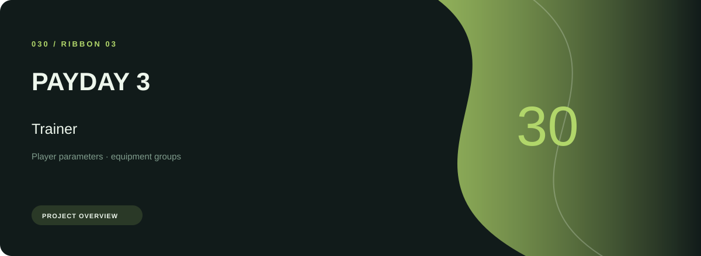
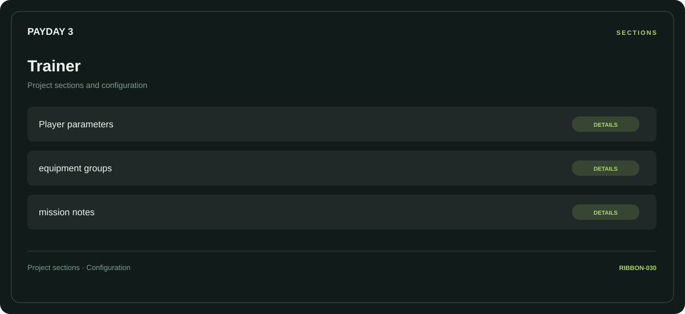

# ⚡ PAYDAY 3 Trainer

**Player parameters · Equipment groups · Mission notes**

## ⚡ Features

A task-oriented PAYDAY 3 trainer workspace: player parameters first, equipment groups next, and mission notes as the final reference area.

### ⚙️ Player parameters

Character-related parameters and the settings associated with the selected category.

### 🧩 Equipment groups

Equipment categories and the associated selection or configuration options.

### ⌨️ Mission notes

Session and activity information grouped by the task or context it belongs to.

## 🖥️ Project navigation

## 📥 Download

The button and cover open the project's download page. Use the information supplied with the downloaded package for installation and release-specific requirements.

## 📚 Project documentation

- [Feature reference](docs/FEATURES.md)
- [Download information](docs/DOWNLOAD.md)
- [Project page](index.html)

---

PAYDAY 3 Trainer · Program documentation and download information.
